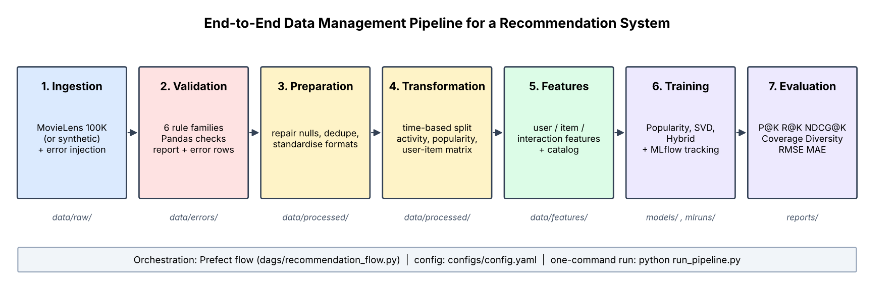

# End-to-End Data Management Pipeline for a Recommendation System

DM4ML Assignment 2. A reproducible, config-driven pipeline that ingests MovieLens 100K,
validates and prepares it, serves features from a small feature store, trains three
recommenders tracked in MLflow, evaluates them, and orchestrates everything with Prefect.



```
ingest -> validate -> prepare -> transform -> features -> train -> evaluate
```

## Quick start

### Google Colab (recommended)
Open `notebooks/colab_runner.ipynb` in Colab and run the cells top to bottom. It installs
dependencies, runs the pipeline, shows every result you need for screenshots, runs the tests,
and builds the final PDF.

### Local machine
```bash
git clone https://github.com/YOUR_USERNAME/recommendation-pipeline.git
cd recommendation-pipeline
python -m venv .venv && source .venv/bin/activate      # Windows: .venv\Scripts\activate
pip install -r requirements.txt
python run_pipeline.py                                  # whole pipeline, one command
pytest -q                                               # unit tests
python -m src.reporting.build_report                    # reports/final_report.pdf
```

Useful flags: `--engine plain|prefect`, `--source synthetic` (offline), `--only features train evaluate`.
If MovieLens cannot be downloaded the ingestion stage logs a warning and falls back to documented
synthetic data, so the pipeline always runs.

## Project structure
```
recommendation-pipeline/
├── configs/config.yaml        all paths, thresholds, seeds, hyper-parameters
├── data/{raw,processed,features,errors}
├── src/
│   ├── ingestion/             MovieLens download, synthetic generator, defect injection
│   ├── validation/            rule-based checks, error dataset, validation report
│   ├── preparation/           cleaning + format standardisation
│   ├── transformation/        time-based split, activity/popularity tables, sparse matrix
│   ├── features/              feature store + registry/catalog
│   ├── training/              models, MLflow tracking wrapper, train stage
│   ├── evaluation/            metrics + evaluation stage
│   ├── orchestration/         stage list + run recorder (shared by Prefect and plain runner)
│   └── reporting/             architecture/DAG diagrams, PDF report builder
├── dags/recommendation_flow.py   Prefect flow (the orchestration DAG)
├── models/  reports/  tests/  notebooks/  docs/
├── run_pipeline.py            one-command entry point
└── requirements.txt
```

## What each stage does

| Stage | Output | Notes |
|---|---|---|
| Ingestion | `data/raw/*.csv` | MovieLens 100K (users, items+genres, ratings). Known defects are injected into a **copy** (originals kept in `data/raw/original/`) so validation has real problems to catch. |
| Validation | `reports/validation_report.{md,json}`, `data/errors/*_errors.csv` | Missing values, duplicates, data types, rating range, timestamp range, referential integrity. Fatal rows are rejected with a `failure_reason`; repairable master-data gaps are kept as warnings. |
| Preparation | `data/processed/*_clean` | Repairs age/gender/title, standardises text and datetimes, one rating per (user, item). |
| Transformation | `train`, `test`, `user_activity_summary`, `item_popularity`, `user_item_matrix.npz` | **Global time-based split** (80/20 by timestamp). Everything derived from train only. |
| Features | `data/features/*`, `reports/feature_catalog.{md,csv}` | User, item and interaction features; one `FeatureStore` class used by training and prediction; cold-start defaults. |
| Training | `models/*.pkl`, MLflow runs | Popularity baseline, SVD matrix factorisation, SVD + genre hybrid. |
| Evaluation | `reports/model_evaluation.{md,csv}`, `model_comparison.png` | P@K, R@K, NDCG@K, Coverage, Diversity, RMSE, MAE. Metrics are logged to the same MLflow runs. |
| Orchestration | `reports/run_status.json`, `docs/dag_run.png` | Task dependencies enforced by Prefect; every run records per-stage status and duration. |

## Feature catalog
See [`reports/feature_catalog.md`](reports/feature_catalog.md) (generated from the registry in
`src/features/feature_store.py`: name, entity, description, formula, source, type).

## Evaluation protocol
* Relevant item = test rating >= 4. Candidates = whole catalogue minus items the user rated in train.
* Metrics at K = 10 over test users that have train history ("warm" users); the number of cold-start
  test users is reported. Set `evaluation.warm_users_only: false` to include them (they fall back to popularity).
* Coverage = share of the catalogue recommended to at least one user. Diversity = mean pairwise genre dissimilarity inside a list.
* RMSE / MAE are computed on all test ratings by the SVD rating model (user/item biases + low-rank residual).
  The hybrid reuses the SVD rating predictions, so its RMSE/MAE equal the SVD model's by construction.
* Seeds are fixed in `configs/config.yaml`.

## Design decisions
* Config-driven stages -> one place to change thresholds, K, seed and split ratio.
* Plain-pandas validation instead of Great Expectations/Pandera: lighter, explicit and unit-tested.
* Custom feature layer (Parquet offline store + registry) instead of Feast: no infrastructure, full control, same train/serve code path.
* Storage is Parquet (CSV fallback if `pyarrow` is missing).
* MLflow uses a local SQLite backend in `mlruns/`; a JSON fallback tracker is used if MLflow is not installed.

## Tests
`pytest -q` covers validation rules, leakage-free time split, train-only features, metric formulas on toy examples, model determinism and cold-start handling.

## Limitations
Offline evaluation only; one time-based split; no dedicated cold-start model; feature store has no
online serving or point-in-time joins; hyper-parameters are lightly tuned; MovieLens 100K is small.
